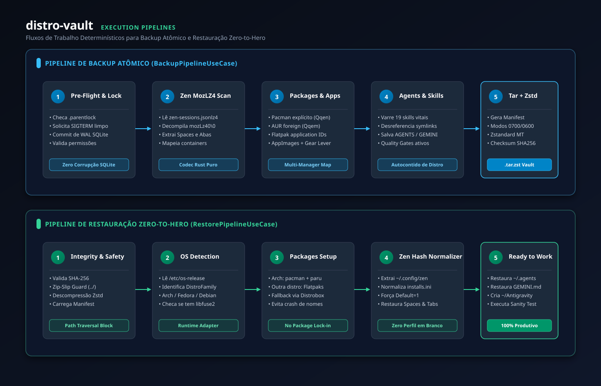

# Distro-Vault 🦀📦

> Ferramenta de alta performance em Rust para backup declarativo, restauração e transição sem atrito entre distribuições Linux (Distro Hopping).


---

## Recursos Principais

- 🌐 **Zen Browser Preservation:** Extração e empacotamento atômico de Workspaces (Spaces), abas abertas e fixadas via codec nativo `mozLz40\0`, além de correção automática do hash de instalação (`installs.ini`/`profiles.ini`).
- 📦 **Multi-Distro Package Engine:** Gerenciamento declarativo para `pacman`, `aur` (`paru`/`yay`), `flatpak`, `dnf`, `apt` e `nix`.
- 🚀 **AppImage & Gear Lever Vault:** Preservação de binários portáteis em `~/AppImages` e garantia da biblioteca `FUSE 2` no host destino.
- 🤖 **Agent Ecosystem Sync:** Exportação declarativa de regras e das 19 skills essenciais de agentes de IA com desreferenciamento de symlinks para execução em qualquer SO.
- ⚙️ **Git Global Config Auto-Deployment:** Backup e restauração automática de `~/.gitconfig` e `~/.config/git/config` com preservação de identidade de autor.
- 🌲 **Restore Granular com Menus Drop:** Interface TUI Ratatui interativa permitindo selecionar exatamente quais componentes restaurar (apps, chaves SSH, pacotes, agentes, config Git e pastas customizadas) com navegação em árvore e menus colapsáveis.
- 🔒 **Secrets & POSIX Integrity:** Preservação estrita de modos `0700` e `0600` em chaves SSH/GPG e compactação Zstandard de alta velocidade com Zip-Slip Guard.

---

## Pipelines de Execução



---

## Arquitetura (Clean Architecture)

Construído como um **Cargo Workspace** modular com separação física por crates:
* `crates/domain`: Entidades puras, value objects e portas (ports).
* `crates/application`: Casos de uso (`BackupPipeline`, `RestorePipeline`, `InspectSnapshot`).
* `crates/adapter-browser`: Codec Mozilla LZ4 nativo e normalizador de perfis.
* `crates/adapter-system`: Adaptador de gerenciadores de pacotes e `/etc/os-release`.
* `crates/adapter-agents`: Scanner de skills e regras de agentes.
* `crates/adapter-storage`: Snapshot engine com Tar, Zstandard e Zip-Slip Guard.
* `crates/adapter-cli`: Interface CLI rica com `clap` e `indicatif`.

---

## Compilação e Testes

```bash
# Compilar todo o workspace
cargo check --workspace

# Executar testes unitários e de integração
cargo test --workspace

# Verificar conformidade de linter com zero warnings
cargo clippy --all-targets --workspace -- -D warnings
```
