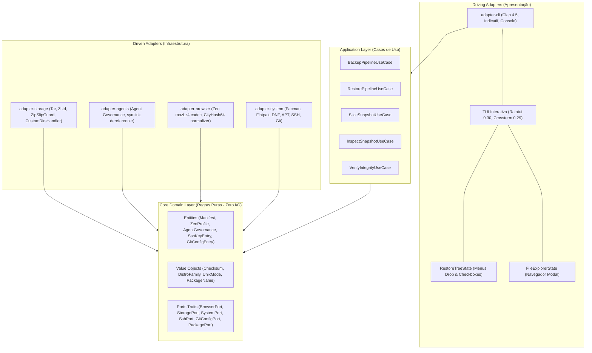

# Distro-Vault 🦀📦

> **Sistema de Alta Performance em Rust para Backup Declarativo, Restauração Cirúrgica, Slicing de Snapshots e Transição sem Atrito entre Distribuições Linux (Distro Hopping).**

[](https://www.rust-lang.org/)
[](LICENSE)
[](Cargo.toml)
[](https://github.com/eduardorwll/distro-vault/releases/tag/v1.0.0)


---

## 📖 Visão Geral

O **distro-vault** é uma ferramenta de infraestrutura pessoal projetada para resolver a dor de reinstalar e reconfigurar sistemas Linux durante migrações ou recuperação de desastres (*Disaster Recovery*). Construído sobre os pilares da **Clean Architecture** (Arquitetura Hexagonal) e **Deep Modules**, ele trata o estado do usuário de forma declarativa e atômica.

Seja saltando de um Arch Linux / Omarchy para um Fedora, Debian ou Ubuntu, o `distro-vault` garante que suas sessões do Zen Browser, chaves SSH, identidades Git, regras de agentes de IA, AppImages e pastas de trabalho sejam reconstituídas de maneira imediata, segura e consistente.

---

## 🌟 Principais Recursos

- 🌐 **Preservação Nativa do Zen Browser:**
  - Extração e empacotamento atômico de Workspaces (Spaces), abas fixadas e abas abertas através de codec nativo Rust para `mozLz40\0` (`lz4_flex`).
  - Normalizador automático de hashes de instalação via CityHash64 v1 (UTF-16LE) com injeção automática em `profiles.ini` e `installs.ini`, garantindo `Default=1` e inicialização instantânea no host de destino.
- 📦 **Gerenciamento Declarativo Multi-Distro:**
  - Descoberta inteligente e segregação de pacotes entre Usuário (`DesktopApp`, `CliTool`, `Development`) e Sistema (`Kernel`, `Drivers`, `Audio`, `Network`).
  - Suporte agnóstico para `pacman`, `paru`/`yay` (AUR), `flatpak`, `dnf`, `apt` e `nix`.
- 🤖 **Sincronização de Ecossistema de IA & Governança:**
  - Detecção e catalogação declarativa das 19 skills essenciais e regras do ecossistema de agentes (`AGENTS.md`, `GEMINI.md`).
  - Desreferenciamento físico de links simbólicos: resolve arquivos reais prevenindo quebras em sistemas sem as árvores de symlinks originais.
- ⚙️ **Auto-Deployment da Configuração Global do Git:**
  - Captura transparente de `~/.gitconfig` e `~/.config/git/config`.
  - Preservação da identidade do autor (`user.name`, `user.email`), aliases e configurações com permissão POSIX `0644`.
- 🌲 **Restauração Granular com Menus Drop (TUI):**
  - Árvore interativa no painel de restauração da TUI com foco duplo (`Tab`).
  - Menus drop colapsáveis por categoria e nós folhas individuais para alternar via caixas de seleção (`[x]`/`[ ]`) exatamente o que restaurar.
- 💾 **Geração de Sub-Dumps Derivados (Snapshot Slicing):**
  - Capacidade de selecionar um dump existente e extrair cirurgicamente apenas os componentes desejados para gerar um novo arquivo `.tar.zst` autocontido (via CLI `distro-vault slice` ou tecla `[S]` na TUI).
- 🔁 **Transcrição Canônica Cross-Distro:**
  - O algoritmo `transcribe_path_to_target_home` mapeia automaticamente caminhos de arquivos de origem (`/home/<user_origem>/...`) para o `$HOME` do usuário no destino, eliminando incompatibilidades de nomes de usuário.
- ⚡ **Staging Acelerado em Cache (`--from-staging`):**
  - Detecção automática e reaproveitamento de diretórios já descompactados em cache em `~/.cache/distro-vault/staging/`, permitindo restaurar sistemas pesados em segundos sem overhead de descompressão.
- 📁 **Explorador Unificado de Arquivos (`FileExplorerState`):**
  - Modal interativo (`[A]`) reutilizado para selecionar pastas extras de backup e explorar snapshots no sistema de arquivos.
- 🔒 **Segurança POSIX & Guardiões de I/O:**
  - Imposição rigorosa de modos `0700` (diretórios confidenciais) e `0600` (chaves privadas SSH).
  - Defesa contra **Zip-Slip (CWE-22)** via `ZipSlipGuard` e teto de segurança contra **Decompression Bombs (CWE-409)** com limite de 128 MB.

---

## 🖥️ Guia da Interface Interativa (TUI)

A TUI interativa é desenvolvida com **Ratatui 0.30** e **Crossterm 0.29**, operando em modo raw com proteção RAII (`TerminalGuard`) contra quebra de terminal.

```text
┌──────────────────────── distro-vault :: [F2] 📦 NOVO BACKUP  •  [F3] 🔄 RECUPERAÇÃO ────────────────────────┐
│ ┌─ 📁 Snapshots Locais ──────────────┐ ┌─ 🗂️ Seleção Granular do Dump ─────────────────────────────────────┐ │
│ │ ▶ distro-vault-20261024.tar.zst    │ │   [x] ▼ Pacotes do Sistema (152 selecionados)                    │ │
│ │   distro-vault-subset.tar.zst      │ │       ├── [x] alacritty • Terminal Emulator                      │ │
│ │                                    │ │       └── [x] ripgrep • Fast search CLI                          │ │
│ │                                    │ │   [x] ▼ Chaves SSH (2 chaves)                                    │ │
│ │                                    │ │       ├── [x] 🔑 id_ed25519 (0600)                               │ │
│ │                                    │ │       └── [x] 📜 id_ed25519.pub (0644)                           │ │
│ │                                    │ │   [x] ▼ Configuração Global Git (1 arquivo)                      │ │
│ │                                    │ │   [x] ▼ Navegador Zen (3 spaces, 18 abas)                         │ │
│ └────────────────────────────────────┘ └──────────────────────────────────────────────────────────────────┘ │
│ ┌─ ⚙️ Parâmetros ──────────────────────────────────────────────────────────────────────────────────────────┐ │
│ │  [P] Pacotes: [x] ATIVADO   •   [D] Dry-Run: [ ] DESATIVADO                                             │ │
│ │  👉 [Enter/R] RESTAURAR  •  💾 [S] SALVAR SUB-DUMP (Gera novo .tar.zst)                                │ │
│ └─────────────────────────────────────────────────────────────────────────────────────────────────────────┘ │
└────────────────────────── [Tab] Focar Árvore  [Espaço] Marcar  [S] Sub-Dump  [R] Restaurar  [Q] Sair ───────┘
```

### Controles Universais da TUI

| Tecla | Contexto | Ação |
| :--- | :--- | :--- |
| `F2` / `F3` / `M` | Global | Alterna em tempo real entre o **Modo Backup** e o **Modo Recuperação**. |
| `Tab` | Modo Backup | Alterna entre as 8 abas de componentes do sistema. |
| `Tab` | Modo Recuperação | Alterna o foco entre a **Lista de Snapshots** (esquerda) e a **Árvore de Seleção** (direita). |
| `↑` / `↓` / `j` / `k` | Listas | Navegação vertical entre linhas, itens ou nós da árvore. |
| `Enter` / `→` / `←` / `e` | Árvore | Expande ou recolhe o menu drop da categoria selecionada. |
| `Espaço` / `x` | Listas / Árvore | Alterna o estado de seleção (`[x]` ↔ `[ ]`) do item ou da categoria em lote. |
| `A` | Backup / Restore | Abre o **Explorador Unificado de Arquivos** para adicionar pastas ou carregar dumps. |
| `P` | Modo Recuperação | Alterna a reinstalação automática de pacotes do sistema (SIM / NÃO). |
| `D` | Modo Recuperação | Alterna o modo de simulação **Dry-Run** (LIGADO / DESLIGADO). |
| `R` / `F10` | Modo Recuperação | Executa a restauração completa dos componentes selecionados no sistema. |
| `S` | Modo Recuperação | **Salva um novo Sub-Dump (`.tar.zst`)** contendo exclusivamente os itens marcados. |
| `Enter` / `F10` | Modo Backup | Inicia a criação do snapshot declarativo no disco. |
| `Esc` / `Q` | Global | Fecha modais abertos ou encerra a aplicação com restauração limpa do terminal. |

---

## ⌨️ Referência Completa da Linha de Comando (CLI)

O `distro-vault` pode ser operado de forma totalmente não-interativa e automatizada em scripts via Clap 4.5.

### 1. Criar Snapshot (`backup`)

```bash
# Iniciar TUI interativa para seleção e personalização
distro-vault backup -i

# Snapshot padrão não-interativo salvo em ~/Antigravity/backups/
distro-vault backup

# Definir caminho do arquivo e adicionar diretórios extras
distro-vault backup -o /mnt/external/meu-backup.tar.zst \
  --add-dir ~/Projetos/distro-vault \
  --add-dir ~/.config/nvim

# Excluir pacotes, chaves SSH ou skills específicas
distro-vault backup \
  --exclude-package steam \
  --exclude-package discord \
  --no-ssh \
  --dry-run
```

### 2. Restaurar Sistema (`restore`)

```bash
# Iniciar diretamente no Modo Recuperação da TUI
distro-vault restore

# Restaurar arquivo específico instalando pacotes de sistema
distro-vault restore /caminho/do/snapshot.tar.zst --install-packages

# Aceleração instantânea via staging em cache
distro-vault restore /caminho/do/snapshot.tar.zst \
  --from-staging ~/.cache/distro-vault/staging/meu-snapshot/

# Simulação (Dry-Run) sem modificar o disco ou pacotes
distro-vault restore /caminho/do/snapshot.tar.zst --dry-run
```

### 3. Fatiar e Gerar Sub-Dumps (`slice`)

```bash
# Extrair somente o que for necessário para gerar um novo snapshot derivado
distro-vault slice /backups/snapshot-completo.tar.zst \
  -o /tmp/snapshot-leve.tar.zst \
  --no-ssh \
  --no-zen \
  --exclude-package libreoffice

# Abrir o dump na TUI para seleção visual e exportação
distro-vault slice /backups/snapshot-completo.tar.zst -i
```

### 4. Inspecionar Snapshot (`inspect`)

```bash
# Inspeção rápida em milissegundos sem descompactar
distro-vault inspect /backups/distro-vault-20261024.tar.zst

# Saída estruturada em JSON para pipelines e scripts
distro-vault inspect /backups/distro-vault-20261024.tar.zst --json
```

### 5. Validar Integridade (`verify`)

```bash
# Validação criptográfica do hash SHA-256 e teste de blocos Zstd
distro-vault verify /backups/distro-vault-20261024.tar.zst
```

---

## 🏗️ Arquitetura e Estrutura de Crates

O projeto adota rigorosamente a **Clean Architecture (Hexagonal)** com dependências apontando estritamente para dentro:



| Crate | Responsabilidade |
| :--- | :--- |
| `crates/domain` | Entidades puras, Value Objects, contratos de Portas (traits) e erros tipados. **Zero I/O e zero dependências de infraestrutura.** |
| `crates/application` | Casos de uso e orquestração dos fluxos de Backup, Restore, Slice, Inspect e Verify. |
| `crates/adapter-browser` | Codec Mozilla LZ4 nativo (`mozLz40\0`) e normalizador CityHash64 de `profiles.ini` e `installs.ini`. |
| `crates/adapter-system` | Integração com o sistema operacional, `/etc/os-release`, detecção de `/proc`, chaves SSH e gerenciadores de pacotes. |
| `crates/adapter-agents` | Scanner de regras de IA (`AGENTS.md`) e 19 skills com desreferenciamento de symlinks para independência de ambiente. |
| `crates/adapter-storage` | Motor de compactação e streaming `.tar.zst` com sanitização Zip-Slip e preservação de permissões POSIX. |
| `crates/adapter-cli` | Composition Root, CLI com Clap 4.5 e interface TUI rica em Ratatui. |

---

## 🛡️ Segurança e Hardening

| Vetor de Risco | Mitigação Implementada |
| :--- | :--- |
| **Zip-Slip / Path Traversal (CWE-22)** | O `ZipSlipGuard` valida e rejeita caminhos com `..`, prefixos absolutos, escapes para fora da raiz canônica de extração e symlinks ancestrais. |
| **Decompression Bomb (CWE-409)** | O codec `MozLz4Codec` impõe teto de segurança rigoroso de 128 MB antes da alocação de memória na descompactação de sessões. |
| **Command Injection (CWE-78)** | Execução de gerenciadores de pacotes via `execve` direto (sem subshell `sh -c`) com validação de regex nos nomes via Value Object `PackageName`. |
| **Exposição de Credenciais (CWE-732)** | Imposição de permissões POSIX estritas `0700` para diretórios sensíveis (`~/.ssh`) e `0600` para chaves privadas SSH. |
| **Symlink Traversal (CWE-59)** | Desreferenciamento seguro na exportação de skills e verificação defensiva de alvos de symlink na restauração. |

---

## 🗺️ Roadmap Futuro (v1.1.0+)

Conforme planejado na governança do projeto, as próximas iterações focarão no refinamento ergonômico e flexibilidade de I/O:

- [ ] **Personalização Dinâmica de Diretórios de Entrada & Saída:**
  - Modal interativo na TUI para alterar em tempo de execução os caminhos de escaneamento de snapshots (entrada) e diretório padrão de gravação (saída).
  - Persistência das preferências do usuário em arquivo de configuração `~/.config/distro-vault/config.toml`.
- [ ] **Desinchaço e Separação Ergonômica dos Menus na TUI:**
  - Redesenho visual para reduzir a densidade textual nos cabeçalhos e rodapés ("anti-bloat").
  - Extração dos parâmetros de execução (`[P] Pacotes`, `[D] Dry-Run`) para um submenu modal dedicado de configurações.
  - Alternância entre visualização compacta e expandida na árvore hierárquica de componentes.

---

## 🔨 Compilação e Testes

### Pré-requisitos
- Rust 1.75+ (Edição 2021)
- Cargo

```bash
# Compilar todo o workspace em modo debug
cargo check --workspace

# Executar a suíte completa de testes (43 testes unitários e de integração)
cargo test --workspace

# Validar conformidade estrita com Zero Warnings no Clippy
cargo clippy --workspace --all-targets -- -D warnings

# Compilar binário standalone de alta performance otimizado
cargo build --release
```

---

## 📄 Licença

Distribuído sob licença dupla **MIT** ou **Apache-2.0**. Consulte [LICENSE](LICENSE) para mais detalhes.
