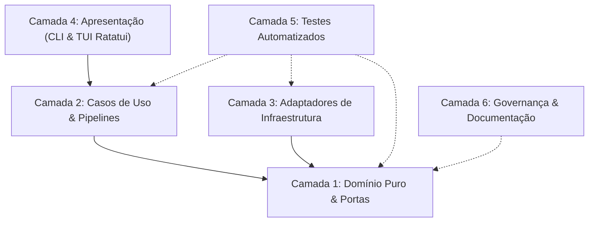

# Análise Arquitetural e Grafo de Conhecimento — distro-vault

> **Gerado via Skill `understand` (`understand-anything`)**  
> **Data:** 23 de Outubro de 2026  
> **Grafo Completo:** [`knowledge-graph.json`](file:///home/eduardorwll/Projects/distro-vault/docs/knowledge-graph.json)

---

## 1. Panorama Geral e Métricas do Sistema

O **distro-vault** é um sistema declarativo de snapshot, backup e migração cross-distro para Linux com suporte à preservação profunda do Zen Browser, aplicativos AppImage, catálogo categorizado de pacotes e governança de agentes de IA.

```
Total de Arquivos Analisados : 66 arquivos (Rust, TOML, Markdown)
Nós Mapeados no Grafo        : 309 nós (arquivos, structs/classes, funções, configs e docs)
Arestas de Relacionamento    : 306 conexões (imports, contains, calls, configures, documents)
Camadas Arquiteturais        : 6 camadas hexagonais bem delimitadas
Etapas do Tour Pedagógico    : 7 etapas estruturadas de aprendizado
Complexidade Global          : Moderada (Clean Architecture de baixo acoplamento)
```

### Distribuição de Nós por Tipo
| Tipo de Nó | Quantidade | Descrição |
|---|---|---|
| `file` | 51 | Arquivos de código fonte Rust (`.rs`) |
| `class` (struct/enum/trait) | 88 | Estruturas de dados, enumerações de domínio e traits de portas |
| `function` | 158 | Funções de regras de negócio, métodos de traits e adaptadores |
| `document` | 7 | Documentação técnica (`README.md`, guias, diagramas SVG) |
| `config` | 5 | Manifestos de pacotes e workspaces (`Cargo.toml`) |

---

## 2. As 6 Camadas Arquiteturais Mapeadas



### Camada 1: Domínio Puro & Portas Hexagonais (`layer:domain`)
- **Responsabilidade:** Núcleo de regras imutáveis do sistema, entidades, Value Objects e interfaces de abstração (portas). Isola 100% da lógica contra detalhes de I/O, sistemas operacionais e bibliotecas externas.
- **Componentes Centrais:**
  - [`Manifest`](file:///home/eduardorwll/Projects/distro-vault/crates/domain/src/entities/manifest.rs): Metadados estruturais completos do snapshot declarativo.
  - [`PackageEntry` & `PackageCategory`](file:///home/eduardorwll/Projects/distro-vault/crates/domain/src/entities/package.rs): Classificação heurística entre softwares de usuário, sistema low-level e bibliotecas de dependência.
  - [`ZenProfile`](file:///home/eduardorwll/Projects/distro-vault/crates/domain/src/entities/zen_profile.rs): Workspaces, abas ativas e sessões do navegador.
  - [`AgentGovernance`](file:///home/eduardorwll/Projects/distro-vault/crates/domain/src/entities/agent_governance.rs): Catálogo de regras de governança e skills de IA.
  - [`SelectionFilter`](file:///home/eduardorwll/Projects/distro-vault/crates/domain/src/entities/selection_filter.rs): Regras de inclusão/exclusão de pacotes e skills no snapshot.
  - **Portas (Traits):** [`BrowserPort`](file:///home/eduardorwll/Projects/distro-vault/crates/domain/src/ports/browser_port.rs), [`PackagePort`](file:///home/eduardorwll/Projects/distro-vault/crates/domain/src/ports/package_port.rs), [`StoragePort`](file:///home/eduardorwll/Projects/distro-vault/crates/domain/src/ports/storage_port.rs), [`AgentPort`](file:///home/eduardorwll/Projects/distro-vault/crates/domain/src/ports/agent_port.rs), [`SystemPort`](file:///home/eduardorwll/Projects/distro-vault/crates/domain/src/ports/system_port.rs).
  - [`DomainError`](file:///home/eduardorwll/Projects/distro-vault/crates/domain/src/errors.rs): Hierarquia unificada de falhas de domínio.

### Camada 2: Casos de Uso & Pipelines (`layer:application`)
- **Responsabilidade:** Orquestração determinística dos fluxos de trabalho da aplicação.
- **Componentes Centrais:**
  - [`BackupPipelineUseCase`](file:///home/eduardorwll/Projects/distro-vault/crates/application/src/backup.rs): Verificação de lock em navegadores abertos, coleta de itens selecionados, aplicação de filtros e geração streaming do `.tar.zst`.
  - [`RestorePipelineUseCase`](file:///home/eduardorwll/Projects/distro-vault/crates/application/src/restore.rs): Extração com Zip-Slip guard, reconciliação de perfis do Zen Browser via CityHash64, reinstalação de skills e despacho de pacotes (com suporte a `--dry-run`).
  - [`InspectSnapshotUseCase`](file:///home/eduardorwll/Projects/distro-vault/crates/application/src/inspect.rs): Leitura rápida do cabeçalho do stream Zstandard para extrair o manifesto sem descompactar o arquivo.
  - [`VerifyIntegrityUseCase`](file:///home/eduardorwll/Projects/distro-vault/crates/application/src/verify.rs): Validação de hash criptográfico SHA-256 e legibilidade dos blocos.

### Camada 3: Adaptadores de Infraestrutura & Sistema (`layer:adapters-infrastructure`)
- **Responsabilidade:** Implementações de I/O em nível de sistema operacional, arquivos e bibliotecas.
- **Componentes Centrais:**
  - **Navegador (`adapter-browser`):** [`MozLz4Codec`](file:///home/eduardorwll/Projects/distro-vault/crates/adapter-browser/src/mozlz4.rs) (codec LZ4 com magic `mozLz40\0` e guardião anti-bomba de 128 MB) e [`ProfilesIniNormalizer`](file:///home/eduardorwll/Projects/distro-vault/crates/adapter-browser/src/profile_normalizer.rs) (CityHash64 e vinculação `Default=1`).
  - **Armazenamento (`adapter-storage`):** [`TarZstdStorageAdapter`](file:///home/eduardorwll/Projects/distro-vault/crates/adapter-storage/src/archive.rs) com `ZipSlipGuard` e [`CustomDirsHandler`](file:///home/eduardorwll/Projects/distro-vault/crates/adapter-storage/src/custom_dirs.rs).
  - **Sistema Operacional (`adapter-system`):** [`OsReleaseParser`](file:///home/eduardorwll/Projects/distro-vault/crates/adapter-system/src/os_release.rs), [`ProcessMonitor`](file:///home/eduardorwll/Projects/distro-vault/crates/adapter-system/src/process.rs) e adaptadores de pacote ([`PacmanAdapter`](file:///home/eduardorwll/Projects/distro-vault/crates/adapter-system/src/packages.rs), [`AurAdapter`](file:///home/eduardorwll/Projects/distro-vault/crates/adapter-system/src/packages.rs), [`FlatpakAdapter`](file:///home/eduardorwll/Projects/distro-vault/crates/adapter-system/src/packages.rs)).
  - **Agentes IA (`adapter-agents`):** [`AgentScanner`](file:///home/eduardorwll/Projects/distro-vault/crates/adapter-agents/src/scanner.rs) com leitura de YAML frontmatter e desreferenciação física de links simbólicos.

### Camada 4: Apresentação CLI & TUI Interativa (`layer:presentation-cli`)
- **Responsabilidade:** Interface do usuário via terminal interativo (TUI Ratatui) ou flags de linha de comando.
- **Componentes Centrais:**
  - [`main.rs`](file:///home/eduardorwll/Projects/distro-vault/crates/adapter-cli/src/main.rs): Ponto de entrada binário e inicialização.
  - [`di.rs`](file:///home/eduardorwll/Projects/distro-vault/crates/adapter-cli/src/di.rs): `AppContainer` responsável pela injeção de dependências dos adaptadores nos casos de uso.
  - [`args.rs`](file:///home/eduardorwll/Projects/distro-vault/crates/adapter-cli/src/args.rs): Parser de subcomandos Clap 4.5.
  - **TUI Ratatui:** [`TuiApp`](file:///home/eduardorwll/Projects/distro-vault/crates/adapter-cli/src/tui/app.rs) (estado reativo em 7 abas com cabeçalhos de categoria), [`ui.rs`](file:///home/eduardorwll/Projects/distro-vault/crates/adapter-cli/src/tui/ui.rs) (renderizador com `render_stateful_widget` e scroll automático do viewport) e [`TerminalGuard`](file:///home/eduardorwll/Projects/distro-vault/crates/adapter-cli/src/tui/runner.rs) (garantia RAII de restauração do terminal).

### Camada 5: Testes Automatizados & Qualidade (`layer:tests-verification`)
- **Responsabilidade:** Suíte de testes automatizados garantindo conformidade com os Rust Books oficiais.
- **Cobertura:** 33 testes unitários e de integração abrangendo validações de Zip-Slip, decompression bombs, normalização de hashes, roundtrips de serialização e fluxos ponta a ponta.

### Camada 6: Governança & Documentação (`layer:configuration-docs`)
- **Responsabilidade:** Especificações arquiteturais, regras de trabalho (`GEMINI.md`, `AGENTS.md`) e diagramas visuais em formato SVG ([`distro_vault_modules.svg`](file:///home/eduardorwll/Projects/distro-vault/docs/distro_vault_modules.svg), [`architecture.svg`](file:///home/eduardorwll/Projects/distro-vault/docs/architecture.svg)).

---

## 3. Tour Guiado Pedagógico (7 Etapas)

O grafo inclui um roteiro pedagógico sequencial para novos engenheiros que queiram compreender a base de código:

1. **Etapa 1: Visão Geral e Arquitetura do distro-vault**
   - *Foco:* [`README.md`](file:///home/eduardorwll/Projects/distro-vault/README.md) e [`modulos_aplicacao.md`](file:///home/eduardorwll/Projects/distro-vault/docs/modulos_aplicacao.md).
   - *Lição de Rust:* Estruturação de workspaces Cargo com múltiplos crates independentes para otimização de cache e compilação incremental.
2. **Etapa 2: Núcleo de Domínio Puro e Portas Hexagonais**
   - *Foco:* [`manifest.rs`](file:///home/eduardorwll/Projects/distro-vault/crates/domain/src/entities/manifest.rs), [`browser_port.rs`](file:///home/eduardorwll/Projects/distro-vault/crates/domain/src/ports/browser_port.rs) e [`package_port.rs`](file:///home/eduardorwll/Projects/distro-vault/crates/domain/src/ports/package_port.rs).
   - *Lição de Rust:* Uso de traits como contratos imutáveis desacoplados de bibliotecas externas, permitindo testes isolados com mocks.
3. **Etapa 3: Casos de Uso e Pipelines de Orquestração**
   - *Foco:* [`backup.rs`](file:///home/eduardorwll/Projects/distro-vault/crates/application/src/backup.rs) e [`restore.rs`](file:///home/eduardorwll/Projects/distro-vault/crates/application/src/restore.rs).
   - *Lição de Rust:* Propagação idiomática de erros com `Result<T, E>` e operador `?`, assegurando zero chamadas a `.unwrap()` em código de produção.
4. **Etapa 4: Adaptadores de Sistema Linux e Pacotes**
   - *Foco:* [`packages.rs`](file:///home/eduardorwll/Projects/distro-vault/crates/adapter-system/src/packages.rs) e [`os_release.rs`](file:///home/eduardorwll/Projects/distro-vault/crates/adapter-system/src/os_release.rs).
   - *Lição de Rust:* Execução direta de comandos via `std::process::Command` (execve sem `sh -c`) para neutralização de Command Injection (CWE-78).
5. **Etapa 5: Preservação do Zen Browser e Codec MozLZ4**
   - *Foco:* [`mozlz4.rs`](file:///home/eduardorwll/Projects/distro-vault/crates/adapter-browser/src/mozlz4.rs) e [`profile_normalizer.rs`](file:///home/eduardorwll/Projects/distro-vault/crates/adapter-browser/src/profile_normalizer.rs).
   - *Lição de Rust:* Prevenção de Decompression Bombs (CWE-409) através de teto de validação de 128 MB antes de alocações no heap.
6. **Etapa 6: Storage Atômico, Zstandard e ZipSlipGuard**
   - *Foco:* [`archive.rs`](file:///home/eduardorwll/Projects/distro-vault/crates/adapter-storage/src/archive.rs) e [`custom_dirs.rs`](file:///home/eduardorwll/Projects/distro-vault/crates/adapter-storage/src/custom_dirs.rs).
   - *Lição de Rust:* Higienização de caminhos com `ZipSlipGuard` para prevenir Path Traversal (CWE-22) durante a descompactação de arquivos.
7. **Etapa 7: Interface CLI e TUI Interativa Ratatui**
   - *Foco:* [`main.rs`](file:///home/eduardorwll/Projects/distro-vault/crates/adapter-cli/src/main.rs), [`app.rs`](file:///home/eduardorwll/Projects/distro-vault/crates/adapter-cli/src/tui/app.rs) e [`ui.rs`](file:///home/eduardorwll/Projects/distro-vault/crates/adapter-cli/src/tui/ui.rs).
   - *Lição de Rust:* Padrão RAII (Resource Acquisition Is Initialization) com `TerminalGuard` garantindo que o terminal seja restaurado mesmo em situações de pânico ou sinais externos (SIGINT).

---

## 4. Visualização e Comandos Disponíveis

O grafo de conhecimento gerado pode ser explorado e consultado por meio das outras skills da família `understand-anything`:

- **Dashboard Visual Web:**
  ```bash
  # Abre o dashboard visual interativo em navegador local
  /understand-dashboard
  ```
- **Perguntas e Consultas Contextuais:**
  ```bash
  # Faz perguntas sobre a arquitetura diretamente via grafo
  /understand-chat "Como o ZipSlipGuard protege a extração em staging?"
  ```
- **Explicação Detalhada de Símbolos:**
  ```bash
  /understand-explain crates/adapter-browser/src/mozlz4.rs MozLz4Codec
  ```
