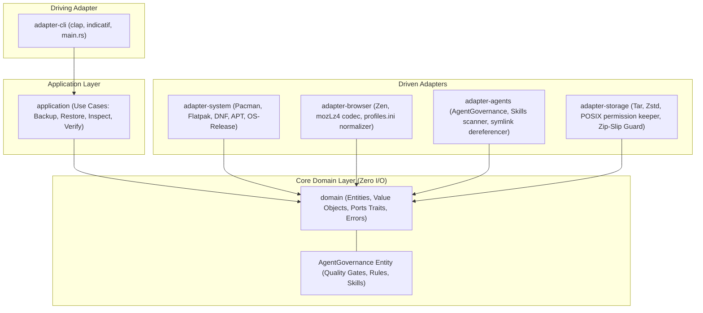

# Estado Arquitetural Atual — distro-vault

Aplicação de Backup e Disaster Recovery Multi-Distro em Rust 2021 com Governança Nativa de Agentes.

---

## 1. Topologia de Crates e Clean Architecture

O projeto implementa rigorosamente os princípios de Clean Architecture (Robert C. Martin) e Módulos Profundos (John Ousterhout), usando isolamento físico por crates:

---

## 2. Invariantes de Design e Regras Arquiteturais

1. **Inward Dependency Rule:** O crate `domain` não possui nenhuma dependência de I/O, banco de dados ou CLI. Somente exporta contratos (Ports), value objects e entidades.
2. **Subssistema de Governança de Agentes (`AgentGovernance`):**
   O `distro-vault` reconhece formalmente como entidade de domínio o **paradigma de governança de agentes**:
   - `AgentGovernance`: modelo estruturado que contém regras (`AGENTS.md`, `GEMINI.md`), catálogo de skills categorizadas (Padrões, Arquitetura, Segurança, Testes) e os Quality Gates (Pre-Approval, 5 Fases, Zero Warning Policy).
   - Ao gerar um vault, o serviço empacota e valida essa governança, permitindo que ao restaurar em qualquer novo computador ou repositório, o ambiente de agentes opere instantaneamente com o mesmo rigor.
3. **Codec MozLZ4 Nativo (Deep Module):** Implementado em Rust puro em `adapter-browser` com `lz4_flex`, decodificando e codificando payloads de sessão sem depender de ferramentas externas.
4. **Resolução do Hash de Instalação do Zen:** O `adapter-browser` reescreve dinamicamente as seções `[Install<HASH>]` em `installs.ini` apontando para o perfil restaurado, impedindo a abertura em branco.
5. **Autonomia das Skills de Agente:** O `adapter-agents` desreferencia links simbólicos de `/usr/share/omarchy/` durante a exportação, transformando as skills em diretórios autocontidos.
6. **Zip-Slip & Path Traversal Guard:** O `adapter-storage` rejeita e aborta qualquer arquivo empacotado que tente escapar do diretório de destino (`../`).
