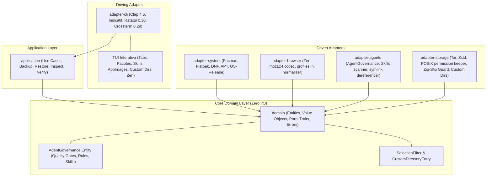

# Estado Arquitetural Atual — distro-vault

Aplicação de Backup e Disaster Recovery Multi-Distro em Rust 2021 com Governança Nativa de Agentes, TUI Interativa Ratatui e Módulo de Diretórios Customizados.

---

## 1. Topologia de Crates e Clean Architecture

O projeto implementa rigorosamente os princípios de Clean Architecture (Robert C. Martin) e Módulos Profundos (John Ousterhout), usando isolamento físico por crates:

---

## 2. Invariantes de Design e Novos Módulos

1. **Inward Dependency Rule:** O crate `domain` não possui nenhuma dependência de I/O, banco de dados ou CLI. Somente exporta contratos (Ports), value objects e entidades.
2. **Módulo de Diretórios Customizados (`CustomDirectoryEntry`):**
   - O usuário pode selecionar quaisquer diretórios arbitrários em seu sistema (ex.: `~/Documents/estudos`, `~/.config/app-x`, pastas de projetos).
   - O `adapter-storage` empacota esses diretórios isolando-os de forma segura sob o prefixo `custom/<nome>` dentro do arquivo `.tar.zst`, calculando tamanho em bytes, contagem de arquivos e respeitando exclusões de padrões (`exclude_patterns`).
3. **Mecanismo de Exclusão Interativa via TUI (`SelectionFilter`):**
   - Modelado no domínio como a estrutura `SelectionFilter` com `HashSet` de itens excluídos (`excluded_packages`, `excluded_skills`, `excluded_appimages`, `excluded_spaces`).
   - A TUI em **Ratatui** permite que o usuário navegue entre abas com `Tab` e alterne exclusões com `Espaço` em tempo real antes de iniciar o snapshot.
4. **Subsistema de Governança de Agentes (`AgentGovernance`):**
   O `distro-vault` reconhece formalmente como entidade de domínio o **paradigma de governança de agentes** do `posta-ai-app` (regras, skills e quality gates).
5. **Codec MozLZ4 Nativo (Deep Module):** Implementado em Rust puro em `adapter-browser` com `lz4_flex`.
6. **Resolução do Hash de Instalação do Zen:** O `adapter-browser` reescreve dinamicamente as seções `[Install<HASH>]` em `installs.ini` apontando para o perfil restaurado.
7. **Zip-Slip & Path Traversal Guard:** O `adapter-storage` bloqueia qualquer extração que tente escapar do diretório alvo.
8. **Transcrição Canônica Cross-Distro & Staging em Cache:** `transcribe_path_to_target_home` remapeia com precisão caminhos de origem `/home/<source_user>/...` para o diretório `$HOME` da máquina alvo sem exigir manipulação manual de arquivos. Suporte a `--from-staging` acelera recuperações repetidas em cache.
9. **Explorador de Arquivos e Diretórios Unificado (`FileExplorerState`):** Componente de interface unificado na camada de apresentação (TUI Ratatui) reutilizado de forma modular tanto para navegação e inclusão de pastas customizadas para backup quanto para escaneamento e seleção de snapshots `.tar.zst` para restauração.
10. **Subsistema de Configuração Global do Git (`GitConfigPort` & `GitConfigEntry`):**
    - Contrato hexagonal puro desacoplado de I/O em `domain/src/ports/git_config_port.rs`.
    - `LinuxGitConfigAdapter` varre `~/.gitconfig` e `~/.config/git/config`, extraindo metadados de autor (`user.name`, `user.email`) e empacotando os arquivos verbatim no snapshot sob `git/`.
    - No restore, restaura com modos POSIX `0644` e pre-unlink defensivo antes da instalação de pacotes de sistema, garantindo recuperação instantânea da identidade Git.
11. **Restauração Granular com Árvore Hierárquica e Menus Drop (`RestoreTreeState`):**
    - Contrato expandido no Core Domain em `SelectionFilter` com flags de sistema (`restore_zen`, `restore_git_config`) e exclusão granular de diretórios customizados (`excluded_custom_dirs`).
    - Na apresentação (TUI Ratatui), a estrutura hierárquica `RestoreTreeState` organiza o manifesto em categorias colapsáveis com menus drop (`Enter/→/←/e`) e nós de itens individuais, permitindo seleção/desseleção em lote ou por item (`Espaço/x`). Foco duplo navegável com `Tab`.
    - No caso de uso `RestorePipelineUseCase`, a extração e implantação de pacotes, AppImages, perfis do Zen Browser, chaves SSH, skills de IA, pastas extras e configurações Git respeitam estritamente as seleções do usuário.
12. **Geração de Sub-Dumps Derivados (Deep Module `SliceSnapshotUseCase`):**
    - Permite extrair um subset podado a partir de um snapshot `.tar.zst` existente sem depender de ferramentas locais (navegador, chaves, pacotes).
    - Desacoplamento estrito exigindo apenas a porta `StoragePort`. Extração em staging temporário protegido por RAII `StagingCleanupGuard`.
    - Poda do `Manifest` e filtragem atômica de arquivos com recálculo determinístico de `total_files`, `total_size_bytes` e geração de novo checksum criptográfico SHA-256.
    - Acionado via CLI (`distro-vault slice`) ou diretamente na TUI através do atalho `[S] Salvar Sub-Dump`.
