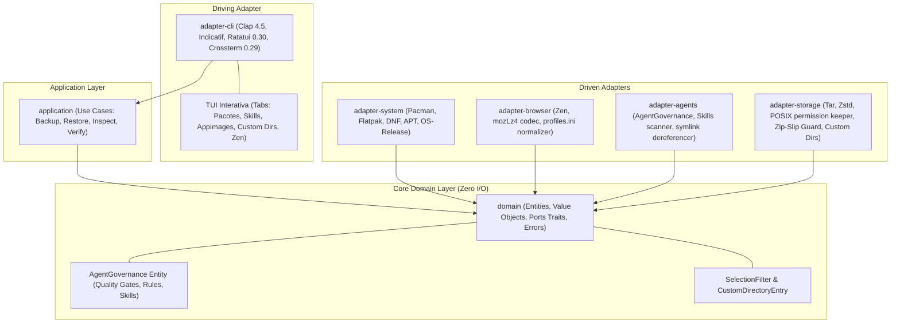

# Estado Arquitetural Atual — distro-vault

Aplicação de Backup e Disaster Recovery Multi-Distro em Rust 2021 com Governança Nativa de Agentes, TUI Interativa Ratatui e Módulo de Diretórios Customizados.

---

## 1. Topologia de Crates e Clean Architecture

O projeto implementa rigorosamente os princípios de Clean Architecture (Robert C. Martin) e Módulos Profundos (John Ousterhout), usando isolamento físico por crates:

---

## 2. Invariantes de Design e Novos Módulos

1. **Inward Dependency Rule:** O crate `domain` não possui nenhuma dependência de I/O, banco de dados ou CLI. Somente exporta contratos (Ports), value objects e entidades.
2. **Módulo de Diretórios Customizados (`CustomDirectoryEntry`):**
   - O usuário pode selecionar quaisquer diretórios arbitrários em seu sistema (ex.: `~/Documents/estudos`, `~/.config/app-x`, pastas de projetos).
   - O `adapter-storage` empacota esses diretórios isolando-os de forma segura sob o prefixo `custom/<nome>` dentro do arquivo `.tar.zst`, calculando tamanho em bytes, contagem de arquivos e respeitando exclusões de padrões (`exclude_patterns`).
3. **Mecanismo de Exclusão Interativa via TUI (`SelectionFilter`):**
   - Modelado no domínio como a estrutura `SelectionFilter` com `HashSet` de itens excluídos (`excluded_packages`, `excluded_skills`, `excluded_appimages`, `excluded_spaces`).
   - A TUI em **Ratatui** permite que o usuário navegue entre abas com `Tab` e alterne exclusões com `Espaço` em tempo real antes de iniciar o snapshot.
4. **Subsistema de Governança de Agentes (`AgentGovernance`):**
   O `distro-vault` reconhece formalmente como entidade de domínio o **paradigma de governança de agentes** do `posta-ai-app` (regras, skills e quality gates).
5. **Codec MozLZ4 Nativo (Deep Module):** Implementado em Rust puro em `adapter-browser` com `lz4_flex`.
6. **Resolução do Hash de Instalação do Zen:** O `adapter-browser` reescreve dinamicamente as seções `[Install<HASH>]` em `installs.ini` apontando para o perfil restaurado.
7. **Zip-Slip & Path Traversal Guard:** O `adapter-storage` bloqueia qualquer extração que tente escapar do diretório alvo.
